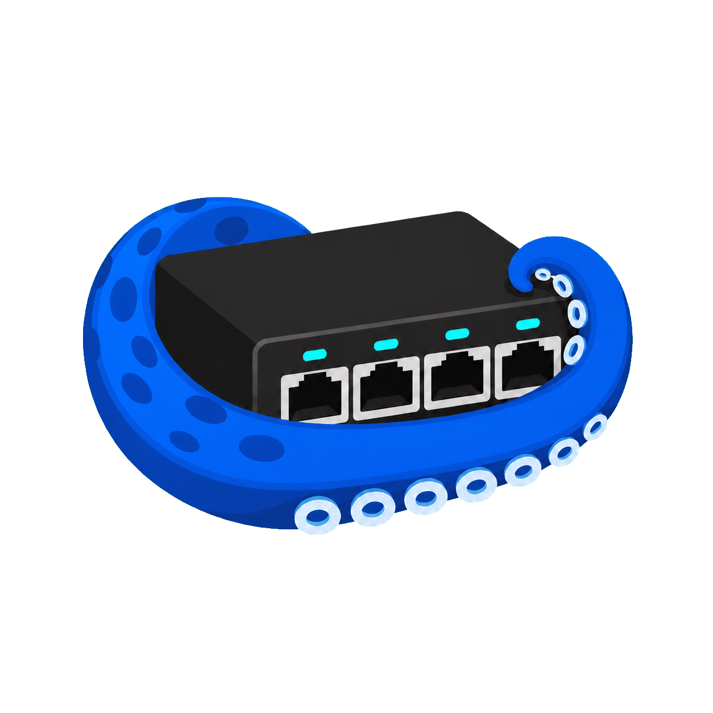

  

# Net Tentacle / 网络触手

> Android Console assistant for reading, reviewing and safely changing network-device configurations.  
> 面向现场网络设备的 Android Console 接入、配置审阅与安全变更助手。

## 中文说明

Net Tentacle 让工程师通过 **Android 手机 + Type-C OTG Console 线** 接入 Cisco、华为、H3C、锐捷等设备。它用于读取当前配置、提供本机风险提示、调用已批准的 AI 服务进行审阅，并生成建议配置。

### 核心原则

- **先读取，再审阅，人工确认。** AI 只提供建议，不会自动修改设备。
- 黑色终端只显示设备真实的 Console 回显，不补造设备输出。
- 写入 AI 建议前会进行命令风险检查、要求人工确认，并自动保存变更前配置。
- 操作日志会保留实际提交到设备的人工命令、AI 配置和危险命令触发记录；密码、密钥、Token 等敏感行会自动隐藏。

### 主要功能

- USB OTG Console 扫描与连接，支持常见 USB 串口芯片。
- Cisco、华为、H3C、锐捷的 Console 参数预设，以及可手动调整的串口参数。
- 一键读取当前配置、查看本地备份、导入配置并进入审阅。
- 本机风险提示、AI 配置审阅、相关配置差异与建议配置生成。
- 普通模式下的受控 AI 配置下发，以及专家模式下的人工终端操作。
- 真人复核内容生成，可复制到微信、飞书或钉钉。

### 安装与使用

1. 在 [Releases](../../releases/latest) 下载最新正式版 APK。
2. 在 Android 系统提示时允许从此来源安装；只从本项目的 Release 页面下载。
3. 使用支持 OTG / USB Host 的 Android 手机连接 Console 线，按应用提示授权 USB。
4. 登录设备后先读取当前配置，再按需审阅或生成建议。

### 重要提示

- 请仅在获授权的设备与网络环境中使用。
- AI 服务地址、设备配置和备份可能涉及企业数据，请使用已获批准的模型服务并遵循所在组织的安全要求。
- 不同厂商和型号的命令存在差异；执行前请由具备权限的操作员核验。

### 反馈

欢迎反馈设备兼容性、现场使用体验和功能建议：bam.ming3@vnet.com

## English

Net Tentacle lets engineers connect to Cisco, Huawei, H3C, Ruijie and similar network devices using an **Android phone and a Type-C OTG Console cable**. It reads the current configuration, provides local risk hints, uses an approved AI service for review, and prepares suggested configuration changes.

### Safety model

- **Read first, review second, confirm manually.** AI provides suggestions only and never changes a device automatically.
- The black terminal shows only real Console output received from the device.
- AI configuration changes are checked for risk, require human confirmation, and trigger a pre-change local backup before being sent.
- The local audit trail records submitted manual commands, AI configurations, and dangerous-command triggers. Sensitive lines containing passwords, keys, or tokens are hidden.

### Key capabilities

- USB OTG Console discovery and connection for common serial adapters.
- Console presets for Cisco, Huawei, H3C and Ruijie, with adjustable serial parameters.
- Current-configuration capture, local backup browsing, import and review.
- Local risk hints, AI review, focused configuration differences and suggested commands.
- Controlled AI configuration submission in standard mode, plus manual terminal access in expert mode.
- Human-review text that can be copied to WeChat, Feishu or DingTalk.

### Install and use

1. Download the latest production APK from [Releases](../../releases/latest).
2. Allow installation from this source when Android requests it. Download only from this project's Release page.
3. Connect an OTG / USB Host-capable Android phone to the Console cable and grant USB permission when prompted.
4. Sign in to the device, read the current configuration, then review or generate suggestions as needed.

### Important notes

- Use only on devices and networks you are authorized to operate.
- AI endpoints, configurations and backups may contain organizational data. Use approved model services and follow your organization's security rules.
- Commands differ across vendors and software versions. A properly authorized operator must review changes before execution.

## Version

Current public test release: **0.1.4**  
See [release notes](RELEASE_NOTES_v0.1.4.md) for changes in this version.
